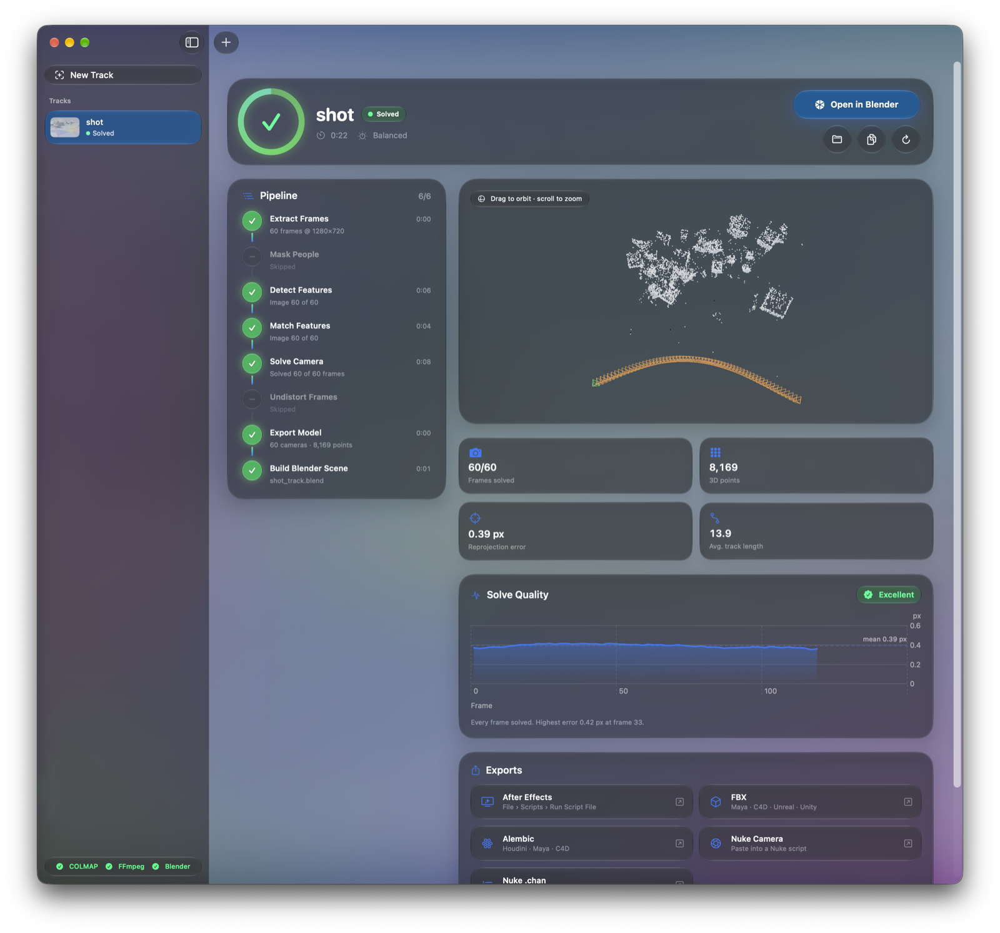
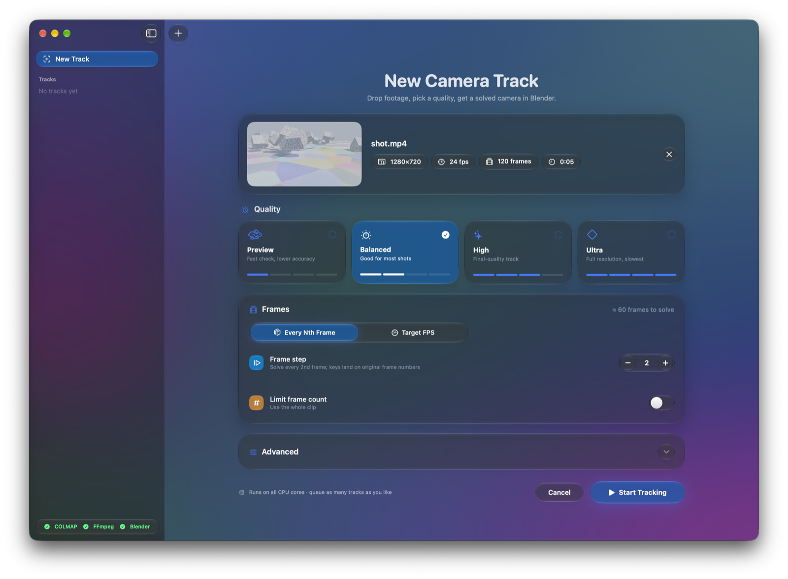
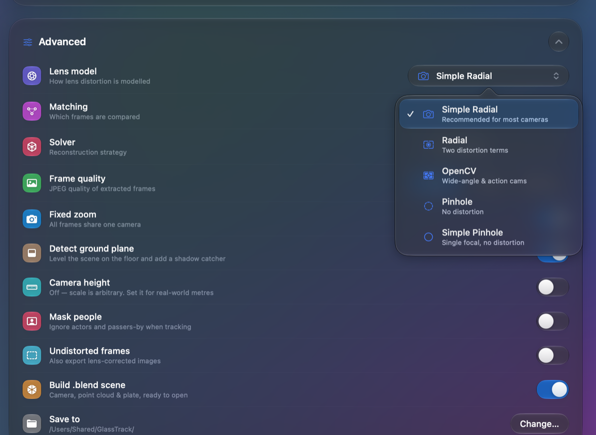
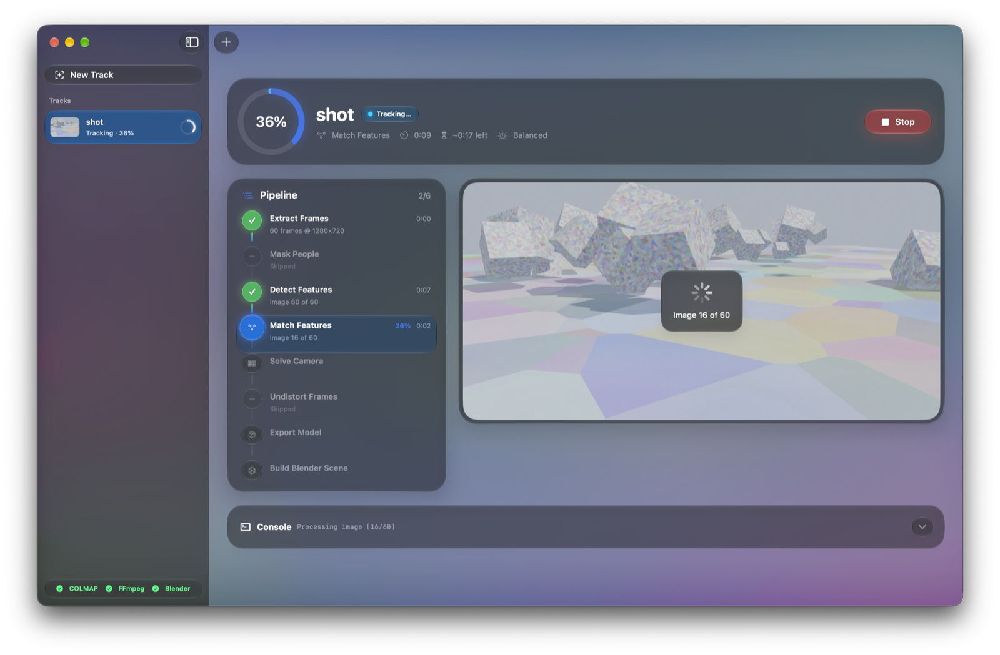
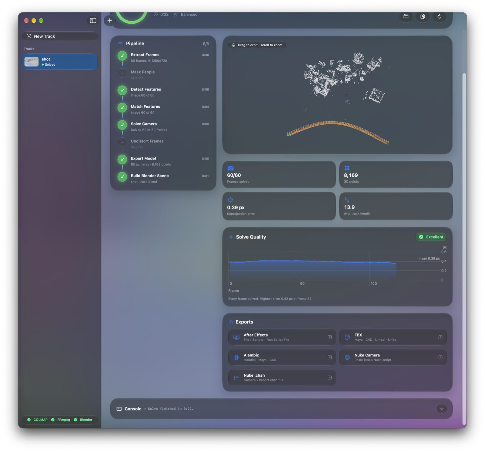
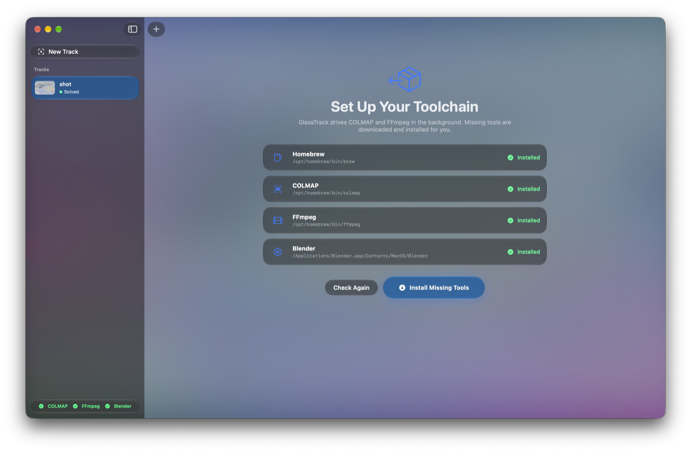

# GlassTrack

A native macOS Liquid Glass app that turns footage into a solved camera for Blender.
It runs [COLMAP](https://colmap.github.io) and FFmpeg in the background.



## Download

Get the latest **[GlassTrack .dmg or .zip from Releases](https://github.com/SkeletonDoctor/GlassTrack/releases/latest)**.

**Requirements:** an Apple Silicon Mac (M1 or later) running macOS 26 Tahoe or newer.

### First launch
The app is not notarized by Apple, so macOS blocks it the first time you open it:
1. Drag **GlassTrack** into Applications, then open it. Dismiss the warning.
2. Go to **System Settings → Privacy & Security**. Scroll down and click **Open Anyway** next to GlassTrack.

Or, in Terminal:
```bash
xattr -dr com.apple.quarantine /Applications/GlassTrack.app
```

On first launch, GlassTrack checks for COLMAP, FFmpeg and Blender. It offers to install any that are missing through Homebrew. If you don't have Homebrew, it opens the official Homebrew installer in Terminal, which asks for your password once.

## What it does
1. **Extract frames.** Video is decoded with hardware acceleration (AVFoundation). Variable-frame-rate, HDR and rotated phone footage is put onto an exact constant-frame-rate timeline, in SDR and upright. You choose every Nth frame or a target FPS, with optional downscaling and a frame cap. You can also drop a folder of photos.
2. **Mask people (optional).** Apple's on-device person segmentation hides actors and passers-by from tracking.
3. **Detect and match features.** COLMAP SIFT, then sequential matching (for video) or exhaustive matching (for photos).
4. **Solve the camera.** COLMAP's incremental `mapper` or its global mapper (GLOMAP). If less than 90% of frames solve, GlassTrack retries once with relaxed settings and keeps the better result.
5. **Build the Blender scene.** Blender runs headless and writes `<name>_track.blend` with:
   - an animated camera on the plate's frame numbers, with matching focal length and lens shift,
   - a coloured point cloud,
   - the plate as the camera background, with lens distortion set on the movie clip,
   - the scene's fps, resolution and frame range,
   - the detected ground plane levelled at z = 0, with a shadow catcher. Give a camera height to get the scene in real metres.
6. **Export for other apps.** After Effects (`.jsx`), FBX, Alembic and Nuke (`.nk` + `.chan`) camera files are written next to the `.blend`.

The app shows live progress for each stage, an ETA, a console, an interactive 3D preview and a per-frame solve-quality chart. Tracks are saved between launches, and a solve interrupted by quitting resumes where it left off.
On first launch, missing tools are installed: Homebrew, then `colmap`, `ffmpeg` and optionally `blender`.

## Screenshots

**Drop in footage and pick a quality.** The app reads the clip's resolution, frame rate and length, and estimates how many frames it will solve.



**Advanced settings** cover the lens model, matching, solver, ground plane, real-world scale and masking people.

<p align="center"></p>

**Live progress** shows each pipeline stage with its own ring, timer and the current frame.



**Check the solve and export it.** The Solve Quality card charts per-frame reprojection error, and the exports work in After Effects, Nuke, FBX apps and Alembic apps.



**First launch** checks for COLMAP, FFmpeg and Blender, and installs anything missing.



## Build from source
You need Xcode 26 or newer.
```bash
./scripts/build_app.sh     # → build/GlassTrack.app (arm64)
```

## Tests
```bash
./scripts/accuracy_test.sh   # solves tests/data/synthetic_dolly.mp4 and compares to ground truth
```
CI (GitHub Actions, macOS) builds the app and runs this test on every push.

## Headless / CLI
```bash
build/GlassTrack.app/Contents/MacOS/GlassTrack --cli shot.mp4 ~/Movies/GlassTrack balanced 2
```

Each project folder holds `images/`, `database.db`, `sparse/`, `sparse_txt/`, `track_meta.json` and `import_colmap_track.py`.
To re-import by hand, run: `blender --python import_colmap_track.py`.

## License
GlassTrack is MIT licensed. COLMAP, FFmpeg and Blender are separate projects under their own licenses. They are installed on your machine and are not bundled with this app.
